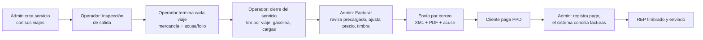

# 00 · Overview — Elogistics Facturación (v2)

> **Propósito**: dar a cualquier agente (o persona) el contexto mínimo para trabajar sin volver a preguntar. Léelo antes que cualquier otro spec.
> Mapa de specs: `01-architecture` (decisiones técnicas) · `02-data-model` (tablas y estados) · `03-api-contract` (endpoints) · `04-facturacion-cfdi` (CFDI + Carta Porte + cancelación) · `05-ui-spec` (sistema visual y pantallas) · `06-cobranza-rep` (pagos, conciliación y complemento de pago) · `07-precio-sugerido` (sugeridor de precio).
> **v2.1 (2 oct 2026)** reemplaza a v1 y a v2. Ver §10 para lo que cambió y §12 para lo que Vlad aún debe entregar.

## 0. Convención — cuándo pedir información al usuario

A lo largo de estos specs hay bloques marcados así:

> 🔴 **INFO REQUERIDA (Vlad)** — descripción del dato que hace falta.

Marcan **datos del mundo real que solo Vlad puede dar**: credenciales y secretos, datos fiscales del emisor, catálogos reales (unidades, operadores, clientes, mercancías, lugares), tarifas, correos y valores por confirmar.

**Regla para cualquier agente:** al llegar a un bloque `INFO REQUERIDA`, **detente y pide esos datos a Vlad antes de continuar esa parte.** No los inventes, no uses RFCs/claves/placeholders que parezcan reales. Para avanzar puedes usar datos *claramente ficticios y rotulados como tales*, pero nada ficticio debe llegar a un timbrado real.

## 0.1 Convención — frontend responsivo

Todo el frontend (admin y operador) debe funcionar en **escritorio, tablet y teléfono**. Las reglas, las clases compartidas y la auditoría automática están en `05-ui-spec §3.1`; terminar una pantalla incluye comprobarla a 390, 820 y 1280 px (`§10` de ese spec). **Regla para cualquier agente:** no entregues una pantalla sin haberla visto a 390 px.

## 1. Qué es

Software web interno para **Elogistics**, empresa de autotransporte en el Estado de México (Toluca/Metepec). Automatiza:
- la **operación** de los servicios de transporte (alta del servicio, ejecución en campo por el operador, inspecciones, kilometraje y combustible),
- la **facturación electrónica** (CFDI 4.0 de Ingreso con Complemento Carta Porte 3.1),
- la **cobranza** (conciliación de pagos PPD y emisión del Complemento de Pago / REP),
- y un **dashboard** de ingresos y cobranza.

**Escala real (dimensiona con esto, NO sobre-ingenierices):** ~8 unidades (camionetas), ~5 operadores, ~6 clientes, decenas de facturas al mes. Un solo emisor. Herramienta interna, no SaaS multi-tenant. Prioridad: **rápido de construir y funcional**.

## 2. El problema que resuelve

Hoy todo se hace a mano en un portal externo: la Carta Porte (180+ campos), el envío por correo con el acuse escaneado, y la conciliación de pagos para emitir complementos de pago (los clientes a veces depositan un monto sin decir qué facturas paga). Es tedioso y propenso a errores que el SAT multa.

## 3. Concepto de dominio central (CAMBIÓ en v2)

> **El administrador crea un SERVICIO y, dentro de él, sus VIAJES.** Ya no existe el paso de "agrupar" viajes sueltos.

- Un **servicio** es la unidad de trabajo y de facturación: **1 cliente + 1 unidad + 1 operador + 1..N viajes → 1 CFDI**.
- Un **viaje** es un movimiento dentro del servicio: **recolección**, **entrega**, o **recolección y entrega**, con su lugar de origen y/o destino.
- **Unidad de registro**: el admin elige **una** camioneta por servicio. En la vida real un servicio puede moverse con más de una, pero la que se elige es la que queda en el registro, en los reportes del operador y en la factura (la Carta Porte admite un solo vehículo por CFDI). No se registran unidades adicionales. La figura de transporte del CFDI es el operador del servicio.

**Ciclo de vida (flujo normal):**

El admin puede cubrir al operador en cualquier paso (subir el acuse desde escritorio, capturar el folio, terminar un viaje), para que la app nunca bloquee la operación.

**Cuándo se factura.** Lo normal es facturar **después** del servicio, porque a veces hay que acordar términos con el cliente antes de timbrar. Excepción: cuando el cliente pide la Carta Porte antes, el admin marca **"Timbrar antes del servicio"** al crear el servicio (casilla apagada por defecto; exige subtotal), timbra con los datos programados y **descarga el PDF y el XML** para enviarlos; el operador ejecuta el servicio después. Por eso el servicio tiene dos estados independientes: el **operativo** (programado → en curso → terminado) y el de **facturación** (pendiente → facturado). Ver `04 §1.1–1.2` y `02 §4`.

## 4. Roles

| Rol | Dónde trabaja | Qué hace |
|-----|---------------|----------|
| **Administrador** | Panel web de escritorio | Gestiona catálogos y accesos, crea servicios con sus viajes, revisa reportes del operador, sube/valida acuses, factura (timbra), descarga y envía PDF/XML, cancela, registra pagos y emite REP, ve el dashboard. |
| **Operador** | PWA en el celular (con **offline**) | Ve sus servicios, hace la inspección de salida, termina cada viaje (mercancía, acuse escaneado o folio), y al final reporta km por viaje, nivel de gasolina y cargas de combustible. |

## 5. Reglas de negocio que no son obvias (y muerden)

1. **Acuse según el cliente** (`cliente.modo_acuse`): **escaneo** (foto/escaneo del acuse sellado), **referencia** (solo folio, p. ej. Chemital) o **ninguno**. Las recolecciones nunca exigen acuse.
2. **El emisor es persona física** (régimen 612). "Elogistics" es marca comercial.
3. **Retención 4% de IVA** solo si el receptor es **persona moral**.
4. **Todas las facturas son PPD** (`MetodoPago=PPD`, `FormaPago=99`). Cada pago recibido exige un **REP** a más tardar el **día 5 del mes siguiente** (ver `06`).
5. **El precio casi siempre se ajusta a mano**: el sistema sugiere un **subtotal** y muestra la suma que lo explica (ver `07`); aparece listo para modificar y el total se calcula solo debajo.
6. **La descripción del concepto se autogenera** (unidad, origen, destinos, fecha) y es editable.
7. **El operador nunca ve claves SAT.** Elige mercancías por nombre; las claves van mapeadas.
8. **Modificar los datos fiscales de un servicio facturado** (precio, ruta, mercancía, unidad, operador) exige **cancelar la factura ante el SAT** primero; aplica igual a un timbrado anticipado si algo cambia después. En 2026, una factura de más de $1,000 requiere **aceptación del receptor** (salvo que se cancele dentro del día hábil siguiente a su emisión): la cancelación puede quedar **"en espera"** hasta 3 días hábiles (ver `04 §8`).
9. **Una factura con REP vigente no se puede cancelar**: primero se cancela el REP.
10. **Catálogos**: "eliminar" desde la UI borra definitivamente si el registro nunca se usó; si ya se usó, lo **archiva** (hay facturas que lo referencian). Todo se administra desde la UI, sin tocar código.
11. **Se timbra con el servicio terminado**, salvo que el servicio tenga marcado el **timbrado anticipado** (`04 §1.2`). Una factura no impide que el operador ejecute y reporte el servicio.
12. **Una unidad de registro por servicio**, aunque físicamente participen más camionetas (§3).

## 6. Alcance del MVP

Auth (2 roles) · Catálogos y accesos administrables desde la UI (unidades, operadores + su acceso a la app, clientes, mercancías, lugares) · Servicios con viajes · PWA del operador offline (inspección, cierre de viajes con acuse, cierre del servicio con km, gasolina y cargas) · Facturación CFDI 4.0 + Carta Porte 3.1 vía Facturama con pantalla de revisión editable y subtotal sugerido con desglose · Timbrado anticipado opcional · Descarga de PDF/XML y envío por correo · Cancelación (con aceptación) · Cobranza: registro de pagos, conciliación automática y REP · Dashboard interactivo (ingresos, por cobrar, cancelaciones en espera) · Export a Excel.

## 7. No-goals (ahora)

- No multi-empresa, no app nativa, no GPS/tracking en vivo, no optimización de rutas.
- No microservicios, colas, workers ni event sourcing.
- No egresos en el dashboard: ni facturas de proveedores ni gasto en combustible. El combustible sí se captura (reportes del operador), pero no se grafica; ver backlog §9.

## 8. Fases de construcción

Cada fase es una rebanada vertical (DB + API + UI) desplegable en Railway.

| Fase | Nombre | Entrega |
|---|---|---|
| 0 ✅ | Andamiaje | Hecha. Repo, auth, PWA shell, deploy, spike Facturama. Sin cambios. |
| 1 | Catálogos y accesos | CRUD desde la UI de unidades, operadores (+ acceso a la app), clientes, mercancías, lugares; archivar/restaurar; usuarios admin. |
| 2 | Servicios y viajes | El admin crea servicios con sus viajes (y marca si se timbran antes), los edita, duplica y cancela; sube acuses y puede cerrar viajes en nombre del operador. |
| 3 | Operación en campo | PWA del operador: inspección de salida, terminar viajes, cierre con km, medidor de gasolina y cargas; offline e idempotencia. |
| 4 | Facturación | Subtotal sugerido con desglose, pantalla "Facturar" (precargado editable + acuse), validación, timbrado normal y anticipado, descarga de PDF/XML, correo, cancelación. |
| 5 | Cobranza y REP | Por cobrar por cliente, registrar pagos, conciliación automática, REP timbrado y enviado, vencimientos del día 5. |
| 6 | Dashboard y reportes | Dashboard interactivo de ingresos y cobranza tipo el de referencia, pendientes operativos, export a Excel. |

Archivos de fase: `fase-1-catalogos.md` … `fase-6-dashboard.md`. Los archivos v1 `fase-2-viajes.md`, `fase-3-servicios.md` y `fase-5-entrega.md` quedan **obsoletos**.

## 9. Backlog y ganchos de diseño (NO construir ahora)

Estas funcionalidades no se implementan en el MVP, pero el modelo de datos ya captura lo necesario para construirlas sin migraciones dolorosas:

| Funcionalidad futura | Qué datos del MVP la habilitan |
|---|---|
| **Sueldos de operadores** calculados por servicios realizados | `servicio.operador_id`, viajes por servicio, km reportados, fechas, subtotal facturado. Falta definir el esquema de pago (por viaje, por servicio, % del flete, por km). |
| **Monitoreo de unidades**: gasto de gasolina por periodo, ingreso generado, ratio (gasolina + operador) / ingreso | `carga_combustible` (litros, $/L, importe, unidad, fecha), niveles de tanque al salir/llegar + `unidad.capacidad_tanque_l`, odómetro, km por viaje, `servicio.subtotal` por unidad. Ojo: todo se atribuye a la **unidad de registro**; si en la práctica participó otra camioneta, no queda registrada. |
| **Costo teórico de ir a un lugar frecuente** con una unidad dada | Catálogo `lugar`, km por viaje hacia cada lugar, consumo derivado por unidad. |
| **Egresos completos** (CFDI recibidos de proveedores, por pagar, solicitudes de cancelación por aprobar) | Requiere descarga de CFDI recibidos (SAT o PAC). Fuera del MVP. |
| **Gasto en combustible en el dashboard** | Las cargas ya se capturan (`carga_combustible`); en el MVP solo se ven en el detalle de cada servicio. |
| **Solicitudes por WhatsApp → servicio** (idea de n8n) | `POST /servicios` ya acepta el servicio completo en una sola llamada. |

## 10. Cambios respecto a v1

| Tema | v1 | v2 |
|---|---|---|
| Alta de trabajo | Viajes sueltos que luego se "agrupan" en servicio | Se crea el servicio y dentro sus viajes. Se eliminan las pantallas y endpoints de agrupar/desagrupar. |
| Unidad y operador | Por viaje | Por servicio (Carta Porte = 1 vehículo por CFDI) |
| Ubicaciones | Texto libre + CP en el viaje | Catálogo `lugar` (CP, estado, municipio, RFC/nombre destinatario) reutilizable |
| Operador | Solo cerraba viajes | Inspección de salida, cierre de viajes, cierre del servicio (km, gasolina, cargas) |
| Precio | Se tecleaba al agrupar | Sugerido automáticamente; pantalla "Facturar" centrada en ajustar el precio |
| Facturar | Botón sobre servicio "listo" | Pantalla de revisión con todo precargado y editable + visor de acuse |
| Cancelación | Directa | Con aceptación del receptor (estado "en espera") |
| REP | Backlog | En el MVP, con conciliación automática de pagos |
| Dashboard | Métricas simples | Réplica interactiva de la parte de ingresos del dashboard de referencia |
| Catálogos | CRUD | CRUD + accesos de operadores + archivar/restaurar desde la UI |

**Cambios de v2.1 sobre v2** (2 oct 2026):
- **Timbrado anticipado**: casilla al crear el servicio (apagada por defecto, exige subtotal) para timbrar antes del traslado y descargar PDF/XML.
- El estado del servicio se separa en **operativo** y **de facturación** (`02 §4`); "facturado" ya no es un estado operativo.
- **Unidad de registro**: una camioneta por servicio aunque participen más.
- El **subtotal sugerido** llega listo para modificar, con la suma que lo explica (`desglose`) y el total calculado debajo.
- La conciliación muestra **los servicios** de cada combinación sugerida, para corroborar.
- El dashboard **no** incluye combustible ni egresos.
- Cobro de servicios con varios destinos: **en stand-by** (`07 §2.1`).
- Recordatorio de **costos y tarifas pendientes** (§12, `07 §5` y aviso dentro de la app).

## 11. Glosario

- **CFDI**: Comprobante Fiscal Digital por Internet, versión 4.0.
- **Carta Porte**: complemento del CFDI que ampara el traslado de mercancías, versión 3.1.
- **CFDI de Ingreso (I)**: el que emite el transportista que cobra el flete (nuestro caso).
- **CFDI de Pago (P) / REP**: Recibo Electrónico de Pago (Complemento de Pagos 2.0); se emite al recibir el pago de una factura PPD.
- **PAC**: Proveedor Autorizado de Certificación; aquí **Facturama**.
- **Timbrar**: certificar el CFDI ante el SAT; se obtiene el **UUID** (folio fiscal).
- **PPD / PUE**: Pago en Parcialidades o Diferido / Pago en Una Exhibición.
- **Saldo insoluto**: lo que falta por pagar de una factura.
- **Acuse**: comprobante sellado por el cliente de que se entregó la mercancía.
- **Figura de transporte**: el operador (chofer) con RFC y número de licencia.
- **Lugar**: origen o destino frecuente (planta del cliente, cliente del cliente, bodega).
- **Inspección de salida**: checklist del operador antes de iniciar el servicio.
- **Cierre del servicio**: reporte final del operador (km por viaje, nivel de gasolina, cargas).
- **Unidad de registro**: la camioneta que el admin asigna al servicio; es la que va en reportes y en la Carta Porte aunque participen otras.
- **Timbrado anticipado**: timbrar la factura con Carta Porte antes de ejecutar el servicio, a petición del cliente.
- **Estado operativo / de facturación**: las dos dimensiones del servicio; la primera la mueve la operación, la segunda el timbrado.

## 12. Pendientes de Vlad (recordatorios por fase)

Lista única de lo que Vlad debe entregar o decidir. Cada punto está además como bloque `INFO REQUERIDA` donde se usa. **Agente: al empezar una fase, revisa su fila y pide lo que falte antes de llegar a la parte que lo necesita.**

| Cuándo | Qué falta | Dónde se usa |
|---|---|---|
| Antes de la carga real (Fase 1) | Datos de unidades (incl. tipo de medidor, número de barras y tanque), operadores y sus usuarios, clientes, mercancías y lugares frecuentes | `02 §3`, `fase-1` |
| Fase 1 | Hex del rojo del logo, si no es `#E0353B` | `05 §2` |
| Fase 3 | Si algún "No" de la inspección debe impedir salir; si el odómetro es obligatorio; foto del tablero de cada camioneta | `fase-3` |
| **Fase 4** | **Costos y tarifas para el subtotal sugerido**: tarifas pactadas por cliente y destino, tarifa base, costo por km y redondeo. Sin ellos la sugerencia solo funciona con historial. La app también lo recuerda (aviso en Facturar, en Configuración → Precios y tarifas y en el dashboard). | `07 §5`, `fase-4 H4.6` |
| Fase 4 | Sandbox de Facturama, un CFDI real (XML + PDF), datos del emisor, `FormaPago`, apodo o placa en la descripción, remitente de Resend | `04`, `01 §8` |
| Fase 5 | Un REP real (XML); si se registran cuentas bancarias en el REP; cómo avisan los clientes sus pagos; qué hacer con pagos en exceso o con diferencia de centavos | `06` |
| Fase 6 | Columnas del Excel para el contador | `fase-6` |
| **En stand-by** | **Cómo se cobra un servicio con varios destinos.** Mientras no se defina, la sugerencia para esos servicios solo usa el historial de la misma ruta, el $/km del cliente o la fórmula sin cargo por parada. | `07 §2.1` |

**Decisiones ya confirmadas por Vlad (2 oct 2026)**: inspección de salida una vez por servicio, con gasolina al salir y odómetro opcional · motivo de cancelación 02 para correcciones · se factura después del servicio, salvo timbrado anticipado · una unidad de registro por servicio · dashboard sin combustible ni egresos.
