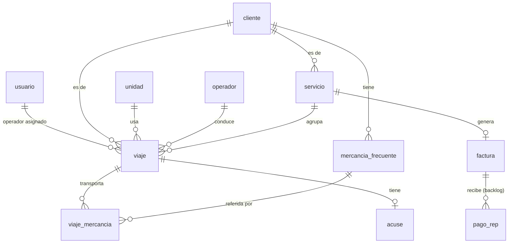

# 02 · Data model

> El modelo de datos es donde un error se paga caro. Sigue estas tablas al pie. Tipos son PostgreSQL; en SQLModel usa el equivalente. Todas las PK son `UUID` (default `uuid4`). Todas las tablas llevan `created_at`, `updated_at` (`timestamptz`, UTC). Dinero es `NUMERIC(12,2)` con `Decimal`.

## 1. Diagrama de relaciones (ERD)



Notas de cardinalidad:
- Un **servicio** agrupa **1..N viajes**; un viaje pertenece a **0..1 servicio** (0 mientras está sin agrupar).
- Un **servicio** genera **0..1 factura** (0 mientras es borrador/listo).
- Un **viaje** de tipo entrega tiene **0..1 acuse** y **0..N mercancías** transportadas.

## 2. Enums (usar como tipos/constrained strings)

```
rol_usuario        = { admin, operador }
tipo_viaje         = { recoleccion, entrega, recoleccion_entrega }
estado_viaje       = { asignado, en_curso, cerrado }        # ciclo del operador
estado_servicio    = { borrador, listo, facturado, cancelado }
modo_acuse         = { escaneo, referencia, ninguno }        # config por cliente
regimen_receptor   = { fisica, moral }                       # decide retención 4%
metodo_pago        = { PUE, PPD }
estado_factura     = { timbrada, cancelada, error }
```

## 3. Tablas

> 🔴 **INFO REQUERIDA (Vlad)** — las tablas de catálogo se llenan con **datos reales de Elogistics que solo Vlad tiene**. Antes del seed / carga de producción, pídele:
> - **Unidades**: por cada camioneta — apodo, placa, año, configuración vehicular (clave SAT), peso bruto vehicular (en **toneladas**), tipo y número de permiso SICT, aseguradora y póliza.
> - **Operadores**: nombre completo, RFC y número de licencia de cada uno.
> - **Clientes**: razón social, RFC, CP fiscal, régimen fiscal, si es **persona física o moral** (define la retención 4%), uso de CFDI, método de pago (PUE/PPD), **modo de acuse** (escaneo/referencia/ninguno) y correo de facturación.
> - **Mercancías frecuentes** por cliente: nombre humano y sus claves SAT (`BienesTransp`, `ClaveUnidad`).
> - **Datos del emisor** (persona física): ver `04-facturacion-cfdi §1`.
>
> Mientras no los tengas, trabaja con datos **ficticios rotulados**; nunca los uses para timbrar en real.

### 3.1 `usuario`
| Campo | Tipo | Notas |
|-------|------|-------|
| id | UUID PK | |
| nombre | text | |
| email | text unique not null | login |
| password_hash | text not null | bcrypt |
| rol | rol_usuario not null | |
| operador_id | UUID FK → operador.id null | si el usuario es un operador, lo liga a su ficha |
| activo | bool default true | |

### 3.2 `unidad` (catálogo — la que el admin elige por apodo)
| Campo | Tipo | Notas |
|-------|------|-------|
| id | UUID PK | |
| apodo | text not null | lo que ve el admin: "Saveiro Roja", "Ram Amarilla" |
| placa | text not null | `PlacaVM` |
| anio_modelo | int | `AnioModeloVM` |
| config_vehicular | text not null | clave SAT `c_ConfigAutotransporte` (ej. `C2`, `VL`) |
| peso_bruto_vehicular | NUMERIC(8,2) | **en toneladas** (ver `04 §validación`; ojo: NO kg) |
| perm_sct | text not null | tipo de permiso, clave SAT (ej. `TPAF01`) |
| num_permiso_sct | text not null | número del permiso SICT |
| aseguradora_resp_civil | text | `AseguraRespCivil` |
| poliza_resp_civil | text | `PolizaRespCivil` |
| activo | bool default true | |

> El **apodo** es la única cosa que el admin ve/elige; el resto se mapea a la Carta Porte automáticamente.

### 3.3 `operador` (catálogo — figura de transporte)
| Campo | Tipo | Notas |
|-------|------|-------|
| id | UUID PK | |
| nombre | text not null | `NombreFigura` |
| rfc | text not null | `RFCFigura` |
| num_licencia | text not null | `NumLicencia` — obligatorio en el complemento |
| activo | bool default true | |

### 3.4 `cliente` (catálogo — receptor)
| Campo | Tipo | Notas |
|-------|------|-------|
| id | UUID PK | |
| razon_social | text not null | `Receptor.Nombre` |
| rfc | text not null | `Receptor.Rfc` |
| cp_fiscal | text not null | `DomicilioFiscalReceptor` |
| regimen_fiscal | text not null | clave SAT del receptor (ej. `601`) |
| regimen_receptor | regimen_receptor not null | **fisica|moral** → decide retención 4% |
| uso_cfdi | text not null default 'G03' | `UsoCFDI` |
| metodo_pago_default | metodo_pago not null default 'PPD' | la mayoría PPD |
| modo_acuse | modo_acuse not null default 'escaneo' | qué exige el cierre del operador |
| email_facturacion | text | a dónde se envía la factura |
| activo | bool default true | |

### 3.5 `mercancia_frecuente` (catálogo por cliente)
| Campo | Tipo | Notas |
|-------|------|-------|
| id | UUID PK | |
| cliente_id | UUID FK → cliente.id not null | |
| nombre_humano | text not null | lo que ve el operador: "Tarimas de refresco" |
| bienes_transp | text not null | clave SAT `c_ClaveProdServCP` (ej. `12164501`) |
| clave_unidad | text not null | clave SAT `c_ClaveUnidad` (ej. `X4G`) |
| unidad_desc | text | "Caja de cartón" |
| activo | bool default true | |

### 3.6 `viaje`
| Campo | Tipo | Notas |
|-------|------|-------|
| id | UUID PK | puede venir generado por el cliente offline |
| cliente_id | UUID FK → cliente.id not null | |
| unidad_id | UUID FK → unidad.id not null | |
| operador_id | UUID FK → operador.id not null | figura de transporte |
| servicio_id | UUID FK → servicio.id null | null = sin agrupar |
| tipo | tipo_viaje not null | |
| estado | estado_viaje not null default 'asignado' | |
| fecha | date not null | fecha del viaje |
| origen_texto | text | descripción legible del origen |
| origen_cp | text | CP del origen (para Carta Porte) |
| origen_rfc | text | RFC remitente en origen (suele ser el cliente) |
| destino_texto | text | |
| destino_cp | text | |
| destino_nombre | text | nombre del destinatario (puede ser genérico) |
| distancia_km | NUMERIC(8,2) | `DistanciaRecorrida` / `TotalDistRec` |
| hora_llegada | time null | opcional, la captura el operador |
| notas | text null | opcional |
| ref_acuse | text null | referencia del acuse (modo referencia) |
| cerrado_at | timestamptz null | cuándo lo cerró el operador |
| client_action_id | UUID null unique | idempotencia del cierre offline (ver `01 §6`) |

Reglas:
- `recoleccion` usa origen; `entrega` usa destino; `recoleccion_entrega` usa ambos.
- El operador solo puede cerrar viajes de su `operador_id`.

### 3.7 `viaje_mercancia` (qué se transportó en el viaje)
| Campo | Tipo | Notas |
|-------|------|-------|
| id | UUID PK | |
| viaje_id | UUID FK → viaje.id not null | |
| mercancia_frecuente_id | UUID FK → mercancia_frecuente.id null | de dónde salieron las claves |
| descripcion | text not null | copia de `nombre_humano` al momento |
| bienes_transp | text not null | clave SAT (copiada) |
| clave_unidad | text not null | clave SAT (copiada) |
| cantidad | NUMERIC(10,2) not null default 1 | |
| peso_kg | NUMERIC(10,2) not null | `PesoEnKg` |

> Copiamos las claves al `viaje_mercancia` (snapshot) para que un cambio futuro en el catálogo no altere facturas ya hechas.

### 3.8 `acuse`
| Campo | Tipo | Notas |
|-------|------|-------|
| id | UUID PK | |
| viaje_id | UUID FK → viaje.id not null | |
| tipo | modo_acuse not null | escaneo | referencia |
| archivo_key | text null | key en R2 (si escaneo) |
| referencia | text null | folio (si referencia) |
| subido_at | timestamptz | |

### 3.9 `servicio`
| Campo | Tipo | Notas |
|-------|------|-------|
| id | UUID PK | |
| cliente_id | UUID FK → cliente.id not null | todos los viajes deben ser del mismo cliente |
| estado | estado_servicio not null default 'borrador' | |
| subtotal | NUMERIC(12,2) null | se captura al agrupar/facturar |
| descripcion_concepto | text null | autogenerada (unidad/origen/destino/fecha) |
| factura_id | UUID FK → factura.id null | |

### 3.10 `factura`
| Campo | Tipo | Notas |
|-------|------|-------|
| id | UUID PK | |
| servicio_id | UUID FK → servicio.id not null unique | |
| estado | estado_factura not null | |
| uuid_fiscal | text null unique | Folio Fiscal del SAT |
| folio | text null | folio interno/serie |
| metodo_pago | metodo_pago not null | PUE|PPD |
| subtotal | NUMERIC(12,2) not null | |
| iva_trasladado | NUMERIC(12,2) not null | 16% |
| iva_retenido | NUMERIC(12,2) not null default 0 | 4% si receptor moral |
| total | NUMERIC(12,2) not null | |
| xml_key | text null | key en R2 |
| pdf_key | text null | key en R2 |
| facturama_id | text null | id del CFDI en Facturama (para cancelar/consultar) |
| motivo_cancelacion | text null | 01|02|03|04 |
| uuid_sustitucion | text null | si se sustituye por otro CFDI |
| enviado_at | timestamptz null | cuándo se envió por correo |
| timbrado_at | timestamptz null | |

### 3.11 `pago_rep` (BACKLOG — modelar, no implementar)
| Campo | Tipo | Notas |
|-------|------|-------|
| id | UUID PK | |
| factura_id | UUID FK → factura.id not null | |
| monto | NUMERIC(12,2) not null | |
| fecha_pago | date not null | |
| uuid_rep | text null | UUID del complemento de pago |
| xml_key | text null | |

## 4. Máquinas de estado

**Viaje** (`estado_viaje`):
```
asignado ──(operador inicia, opcional)──> en_curso ──(operador cierra)──> cerrado
asignado ────────────────(cierre directo)───────────────────────────────> cerrado
```
`en_curso` es opcional (por si se quiere marcar inicio); el MVP puede ir directo `asignado → cerrado`.

**Servicio** (`estado_servicio`):
```
borrador ──(tiene viajes + subtotal, pasa validación)──> listo
listo ──(timbra OK)──> facturado
facturado ──(cancela factura ante SAT)──> cancelado
cancelado ──(re-editar y re-agrupar)──> borrador
```
Regla dura: un servicio `facturado` es **inmutable** hasta que su factura se cancele. Modificar exige `facturado → (cancelar) → cancelado → borrador`.

**Factura** (`estado_factura`):
```
(timbrado OK) → timbrada
(timbrado falla) → error         # se puede reintentar
timbrada ──(cancelación SAT)──> cancelada
```

## 5. Reglas de integridad

- Todos los viajes de un `servicio` deben compartir `cliente_id`.
- Un `servicio` no pasa a `listo` sin `subtotal` y sin al menos un viaje.
- Un viaje `entrega` cuyo cliente tiene `modo_acuse = escaneo` no se considera cerrado sin `acuse.archivo_key`; con `referencia`, sin `acuse.referencia`; con `ninguno`, no requiere acuse.
- `viaje.client_action_id` es unique → reintentos offline no duplican.
- Borrado: **soft-delete** en catálogos (`activo=false`), nunca hard delete (hay facturas históricas que los referencian).

## 6. Índices sugeridos
- `viaje(operador_id, estado)` — "mis viajes" del operador.
- `viaje(servicio_id)` — agrupar.
- `viaje(cliente_id, fecha)` — agrupar por cliente/fecha.
- `servicio(cliente_id, estado)` — dashboard/listado.
- `factura(uuid_fiscal)`, `factura(estado, timbrado_at)`.
- `viaje(client_action_id)` unique.
