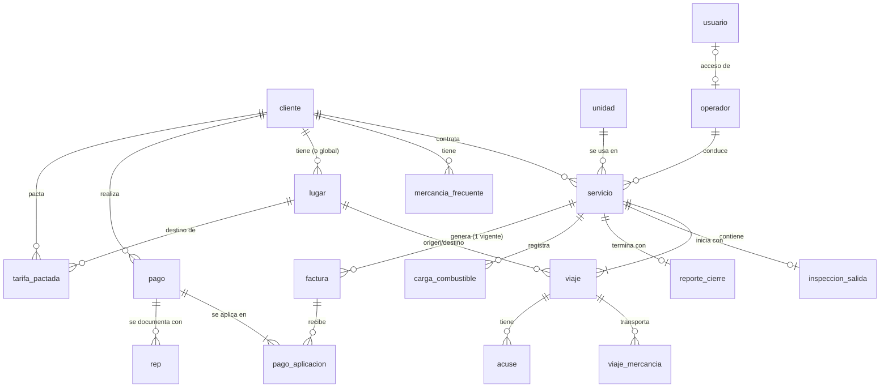

# 02 · Data model (v2)

> El modelo de datos es donde un error se paga caro. Sigue estas tablas al pie. Tipos PostgreSQL; en SQLModel usa el equivalente. Todas las PK son `UUID` (default `uuid4`) salvo `configuracion`. Todas las tablas llevan `created_at`, `updated_at` (`timestamptz`, UTC). Dinero `NUMERIC(12,2)` con `Decimal`.
>
> **Cambios clave vs v1**: el servicio se crea primero y contiene sus viajes (`viaje.servicio_id` NOT NULL); unidad y operador pasan del viaje al servicio; nuevo catálogo `lugar`; nuevas tablas de operación en campo (`inspeccion_salida`, `reporte_cierre`, `carga_combustible`); cobranza real (`pago`, `pago_aplicacion`, `rep`) reemplaza a `pago_rep`; `factura` ya no es 1:1 con servicio (puede haber canceladas + una vigente); precios (`tarifa_pactada`, `configuracion`).
>
> **v2.1**: el estado del servicio se separa en **operativo** (`estado`) y **de facturación** (`estado_facturacion`) para permitir el **timbrado anticipado**; nuevos campos `servicio.timbrado_anticipado`, `viaje.hora_salida_programada` y `viaje.hora_llegada_programada`; la unidad del servicio es la **unidad de registro**.

## 1. Diagrama de relaciones



Cardinalidades clave:
- Servicio: **1 cliente, 1 unidad de registro, 1 operador, 1..N viajes**.
- Servicio → factura: **0..N históricas, máximo 1 vigente** (`timbrada` o `cancelacion_pendiente`).
- Pago → facturas: **N..M** vía `pago_aplicacion`. Pago → REP: 0..N históricos, máximo 1 vigente.

## 2. Enums

```
rol_usuario        = { admin, operador }
estado_servicio    = { programado, en_curso, terminado, cancelado }   # estado OPERATIVO del servicio
estado_facturacion = { pendiente, facturado }                         # del servicio; facturado = tiene factura vigente
tipo_viaje         = { recoleccion, entrega, recoleccion_entrega }
estado_viaje       = { pendiente, terminado }
modo_acuse         = { escaneo, referencia, ninguno }      # config por cliente
tipo_acuse         = { escaneo, referencia }               # lo que efectivamente se registró
regimen_receptor   = { fisica, moral }                     # decide retención 4%
metodo_pago        = { PUE, PPD }
tipo_medidor       = { aguja, barras }                     # medidor de gasolina de la unidad
estado_factura     = { timbrada, cancelacion_pendiente, cancelada, error }
estado_cobro       = { pendiente, parcial, pagada }        # de la factura, derivado del saldo
estado_pago        = { registrado, aplicado, rep_emitido }
estado_rep         = { timbrado, cancelacion_pendiente, cancelado, error }
```

## 3. Tablas

> 🔴 **INFO REQUERIDA (Vlad)** — los catálogos se llenan con **datos reales que solo Vlad tiene**. Antes del seed/carga de producción, pídele:
> - **Unidades**: apodo, placa, año, configuración vehicular (clave SAT), peso bruto vehicular (**toneladas**), capacidad de carga (kg), tipo y número de permiso SICT, aseguradora y póliza, **tipo de medidor de gasolina (aguja o barras, y cuántas barras)** y **capacidad del tanque (litros)**.
> - **Operadores**: nombre, RFC, número de licencia, teléfono, y con qué correo/usuario entrarán a la app.
> - **Clientes**: razón social, nombre comercial, RFC, CP fiscal, régimen fiscal, física/moral, uso de CFDI, modo de acuse, correo(s) de facturación, días de crédito.
> - **Mercancías frecuentes** por cliente: nombre humano, claves SAT (`BienesTransp`, `ClaveUnidad`), peso típico.
> - **Lugares frecuentes**: plantas de los clientes y destinos habituales con CP, estado, municipio y RFC/nombre del destinatario si se conoce.
>
> Mientras no los tengas, usa datos **ficticios rotulados**; nunca para timbrar en real.

### 3.1 `usuario` (creada en Fase 0)
| Campo | Tipo | Notas |
|-------|------|-------|
| id | UUID PK | |
| nombre | text not null | |
| email | text unique not null | identificador de login; para operadores puede ser un usuario sin formato de correo |
| password_hash | text not null | bcrypt |
| rol | rol_usuario not null | |
| operador_id | UUID FK → operador.id null **unique** | liga el acceso a la ficha del operador (Fase 1 agrega FK/unique si Fase 0 no los creó) |
| activo | bool default true | desactivar acceso = `false` |

### 3.2 `unidad`
| Campo | Tipo | Notas |
|-------|------|-------|
| id | UUID PK | |
| apodo | text not null unique | lo que ve todo el mundo: "Saveiro Roja" |
| placa | text not null unique | `PlacaVM` |
| anio_modelo | int | `AnioModeloVM` |
| config_vehicular | text not null | clave SAT `c_ConfigAutotransporte` |
| peso_bruto_vehicular | NUMERIC(8,2) | **toneladas** (no kg) |
| capacidad_carga_kg | NUMERIC(10,2) null | para la regla de sobrepeso (`04 §5`) |
| perm_sct | text not null | clave SAT del tipo de permiso |
| num_permiso_sct | text not null | |
| aseguradora_resp_civil | text | |
| poliza_resp_civil | text | |
| tipo_medidor | tipo_medidor not null default 'aguja' | cómo se dibuja el medidor de gasolina en la PWA |
| num_barras | smallint null | obligatorio y entre 2 y 20 si `tipo_medidor = barras` (CHECK) |
| capacidad_tanque_l | NUMERIC(6,2) null | habilita cálculos de consumo (backlog) |
| tipo_combustible | text null | "Magna", "Premium", "Diésel" (informativo) |
| activo | bool default true | `false` = archivada |

### 3.3 `operador`
| Campo | Tipo | Notas |
|-------|------|-------|
| id | UUID PK | |
| nombre | text not null | `NombreFigura` |
| rfc | text not null | `RFCFigura` |
| num_licencia | text not null | `NumLicencia` |
| telefono | text null | |
| activo | bool default true | |

### 3.4 `cliente`
| Campo | Tipo | Notas |
|-------|------|-------|
| id | UUID PK | |
| razon_social | text not null | `Receptor.Nombre` (tal como en su constancia) |
| nombre_comercial | text not null | lo que se muestra en la UI: "Chemital" |
| rfc | text not null | |
| cp_fiscal | text not null | `DomicilioFiscalReceptor` |
| regimen_fiscal | text not null | clave SAT (ej. `601`) |
| regimen_receptor | regimen_receptor not null | física/moral → retención 4% |
| uso_cfdi | text not null default 'G03' | |
| metodo_pago_default | metodo_pago not null default 'PPD' | |
| modo_acuse | modo_acuse not null default 'escaneo' | |
| emails_facturacion | text[] not null default '{}' | destinatarios de factura y REP |
| dias_credito | int not null default 30 | antigüedad de saldos en cobranza |
| activo | bool default true | |

### 3.5 `mercancia_frecuente`
| Campo | Tipo | Notas |
|-------|------|-------|
| id | UUID PK | |
| cliente_id | UUID FK → cliente.id not null | |
| nombre_humano | text not null | lo que ve el operador |
| bienes_transp | text not null | clave SAT `c_ClaveProdServCP` |
| clave_unidad | text not null | clave SAT `c_ClaveUnidad` |
| unidad_desc | text | "Caja de cartón" |
| peso_kg_sugerido | NUMERIC(10,2) null | precarga el campo kg |
| activo | bool default true | |

### 3.6 `lugar` (nuevo — orígenes y destinos frecuentes)
| Campo | Tipo | Notas |
|-------|------|-------|
| id | UUID PK | |
| cliente_id | UUID FK → cliente.id null | null = lugar compartido por todos los clientes |
| nombre | text not null | "Planta Chemital Toluca", "Guadalupe Limón" |
| rfc_remitente_destinatario | text not null default 'XAXX010101000' | `RFCRemitenteDestinatario` (en la planta del cliente suele ser el RFC del cliente) |
| nombre_remitente_destinatario | text null | `NombreRemitenteDestinatario` |
| calle | text null | |
| num_exterior | text null | |
| colonia | text null | clave SAT `c_Colonia` |
| localidad | text null | clave SAT `c_Localidad` |
| municipio | text null | clave SAT `c_Municipio` (recomendado) |
| estado | text not null | clave SAT `c_Estado` (ej. `MEX`) |
| pais | text not null default 'MEX' | |
| codigo_postal | text not null | |
| referencia | text null | instrucciones para el operador ("entrada por calle lateral") |
| es_origen_predeterminado | bool default false | a lo más uno `true` por cliente: se precarga al crear servicios |
| activo | bool default true | |

> Qué campos de `Domicilio` exige Carta Porte 3.1 y en qué formato: **verificar contra la doc de Facturama**. Mínimo garantizado: CP, estado y país.

### 3.7 `servicio`
| Campo | Tipo | Notas |
|-------|------|-------|
| id | UUID PK | |
| numero | serial unique | número legible: "Servicio #128" |
| cliente_id | UUID FK → cliente.id not null | |
| unidad_id | UUID FK → unidad.id not null | **unidad de registro**: la que va en los reportes y en el Autotransporte de la Carta Porte, aunque físicamente participen más camionetas |
| operador_id | UUID FK → operador.id not null | Figura de transporte |
| fecha | date not null | fecha programada (la del primer viaje) |
| estado | estado_servicio not null default 'programado' | estado **operativo** (§4) |
| estado_facturacion | estado_facturacion not null default 'pendiente' | se actualiza en la misma transacción que el timbrado y que la cancelación confirmada |
| timbrado_anticipado | bool not null default false | casilla "Timbrar antes del servicio" (`04 §1.2`) |
| subtotal | NUMERIC(12,2) null | precio del servicio; opcional hasta facturar, **obligatorio y > 0 si `timbrado_anticipado`** (CHECK) |
| precio_sugerido | NUMERIC(12,2) null | snapshot de la sugerencia mostrada al facturar (para medir qué tan buena es) |
| precio_sugerido_detalle | jsonb null | fuente, confianza y referencias (`07 §4`) |
| descripcion_concepto | text null | null = se autogenera (`04 §2`); con valor = texto editado por el admin |
| metodo_pago | metodo_pago null | override; null = `cliente.metodo_pago_default` |
| uso_cfdi | text null | override; null = `cliente.uso_cfdi` |
| notas | text null | instrucciones generales para el operador |
| iniciado_at | timestamptz null | al registrarse la inspección de salida |
| terminado_at | timestamptz null | al cerrar el servicio |
| terminado_por_admin | bool default false | true si el admin lo cerró sin reporte del operador |
| cancelado_motivo | text null | si `estado = cancelado` (el servicio no se realizó) |
| created_by | UUID FK → usuario.id | |

### 3.8 `viaje`
| Campo | Tipo | Notas |
|-------|------|-------|
| id | UUID PK | |
| servicio_id | UUID FK → servicio.id **not null** | |
| orden | smallint not null | secuencia dentro del servicio; unique (`servicio_id`, `orden`) |
| tipo | tipo_viaje not null | |
| estado | estado_viaje not null default 'pendiente' | |
| fecha | date not null | default = `servicio.fecha` |
| hora_salida_programada | time null | viajes con origen; la captura el admin. Necesaria para timbrar por anticipado |
| hora_llegada_programada | time null | viajes con destino (llegada estimada); la captura el admin. Necesaria para timbrar por anticipado |
| origen_lugar_id | UUID FK → lugar.id null | requerido si `recoleccion` o `recoleccion_entrega` |
| destino_lugar_id | UUID FK → lugar.id null | requerido si `entrega` o `recoleccion_entrega` |
| distancia_km | NUMERIC(8,2) null | **distancia para Carta Porte** (`DistanciaRecorrida`); la captura/ajusta el admin |
| km_reportado | NUMERIC(8,2) null | km que reportó el operador en el cierre; **nunca lo sobrescribe el admin** |
| hora_llegada | time null | la captura el operador (opcional) |
| terminado_at | timestamptz null | |
| terminado_por | UUID FK → usuario.id null | operador o admin |
| notas_admin | text null | instrucciones para este viaje |
| notas_operador | text null | |
| client_action_id | UUID null unique | idempotencia de "terminar viaje" |

Reglas:
- `recoleccion` → origen requerido, destino null; `entrega` → destino requerido, origen null (su origen es la ubicación anterior); `recoleccion_entrega` → ambos.
- Un servicio necesita **≥1 viaje con destino** para poder facturarse (la Carta Porte exige al menos un Destino).

### 3.9 `viaje_mercancia`
| Campo | Tipo | Notas |
|-------|------|-------|
| id | UUID PK | |
| viaje_id | UUID FK → viaje.id not null | viajes de entrega (y recolección+entrega). Las captura el operador al terminar el viaje, o el admin antes (necesario para timbrar por anticipado) |
| mercancia_frecuente_id | UUID FK null | de dónde salieron las claves |
| descripcion | text not null | snapshot de `nombre_humano` |
| bienes_transp | text not null | snapshot |
| clave_unidad | text not null | snapshot |
| unidad_desc | text null | snapshot |
| cantidad | NUMERIC(10,2) not null default 1 | |
| peso_kg | NUMERIC(10,2) not null | `PesoEnKg` |

> Snapshot: editar el catálogo no altera viajes ni facturas pasadas.

### 3.10 `acuse`
| Campo | Tipo | Notas |
|-------|------|-------|
| id | UUID PK | |
| viaje_id | UUID FK → viaje.id not null | |
| tipo | tipo_acuse not null | |
| archivo_key | text null | key en R2 (requerido si `escaneo`) |
| mime | text null | `image/jpeg`, `application/pdf` |
| pagina | smallint not null default 1 | un acuse puede tener varias páginas/fotos |
| referencia | text null | folio (requerido si `referencia`) |
| subido_por | UUID FK → usuario.id | operador o admin |
| subido_at | timestamptz not null | |
| client_action_id | UUID null unique | idempotencia de la subida offline |

### 3.11 `inspeccion_salida` (nuevo)
Una por servicio. Se registra al iniciar el servicio.

| Campo | Tipo | Notas |
|-------|------|-------|
| id | UUID PK | |
| servicio_id | UUID FK → servicio.id not null **unique** | |
| operador_id | UUID FK → operador.id not null | |
| unidad_id | UUID FK → unidad.id not null | snapshot de la unidad inspeccionada |
| unidad_limpia | bool not null | |
| fumigacion_vigente | bool not null | certificado de fumigación vigente |
| botiquin | bool not null | |
| casco_chaleco | bool not null | |
| aceite_ok | bool not null | nivel de aceite óptimo |
| anticongelante_ok | bool not null | nivel de anticongelante óptimo |
| neumaticos_ok | bool not null | |
| extintor_ok | bool not null | carga de extintor óptima |
| todo_ok | bool generated always as (AND de los 8) stored | para filtros y dashboard |
| observaciones | text null | |
| nivel_combustible | NUMERIC(4,3) not null | fracción 0.000–1.000 del tanque al salir |
| lectura_medidor | jsonb not null | lectura cruda (ver abajo) |
| odometro_km | int null | odómetro al salir (recomendado) |
| realizada_at | timestamptz not null | hora en el teléfono |
| registrada_por | UUID FK → usuario.id | |
| client_action_id | UUID unique not null | |

`lectura_medidor` (snapshot del tipo de medidor al momento):
```json
{ "tipo": "aguja", "octavos": 4 }                 // nivel = 4/8
{ "tipo": "barras", "barras": 5, "total": 8 }     // nivel = 5/8
```
Agregar un punto al checklist = migración que agrega una columna bool (decisión consciente: la lista es fija y corta, y las columnas son consultables).

### 3.12 `reporte_cierre` (nuevo)
Uno por servicio. Lo envía el operador al terminar el servicio. Los km por viaje se guardan en `viaje.km_reportado`.

| Campo | Tipo | Notas |
|-------|------|-------|
| id | UUID PK | |
| servicio_id | UUID FK → servicio.id not null **unique** | |
| operador_id | UUID FK → operador.id not null | |
| nivel_combustible | NUMERIC(4,3) not null | al llegar |
| lectura_medidor | jsonb not null | igual que en la inspección |
| odometro_km | int null | al llegar |
| cargo_combustible | bool not null | ¿cargó gasolina durante el servicio? |
| observaciones | text null | |
| cerrado_at | timestamptz not null | |
| client_action_id | UUID unique not null | |

### 3.13 `carga_combustible` (nuevo)
| Campo | Tipo | Notas |
|-------|------|-------|
| id | UUID PK | **puede venir generado en el teléfono** (idempotencia y para subir el ticket después) |
| servicio_id | UUID FK → servicio.id null | en MVP siempre se llena; null reservado para cargas fuera de servicio (backlog) |
| unidad_id | UUID FK → unidad.id not null | |
| operador_id | UUID FK → operador.id null | |
| litros | NUMERIC(7,2) not null | > 0 |
| precio_litro | NUMERIC(7,3) not null | > 0 |
| importe | NUMERIC(10,2) not null | > 0; regla: `|litros × precio_litro − importe| ≤ 1.00` |
| tipo_combustible | text null | |
| ticket_key | text null | foto del ticket en R2 (opcional) |
| cargada_at | timestamptz not null | |
| registrada_por | UUID FK → usuario.id | |

El "total" del reporte de gasolina = Σ `importe` (y Σ `litros`) de las cargas del servicio; se calcula, no se guarda.

### 3.14 `factura`
| Campo | Tipo | Notas |
|-------|------|-------|
| id | UUID PK | |
| servicio_id | UUID FK → servicio.id not null | **no unique**: índice único parcial `WHERE estado IN ('timbrada','cancelacion_pendiente')` |
| estado | estado_factura not null | |
| uuid_fiscal | text null unique | |
| serie | text null | |
| folio | text null | |
| fecha_emision | timestamptz null | `Fecha` del CFDI; base del dashboard por mes |
| metodo_pago | metodo_pago not null | |
| forma_pago | text not null default '99' | |
| uso_cfdi | text not null | |
| subtotal | NUMERIC(12,2) not null | |
| iva_trasladado | NUMERIC(12,2) not null | |
| iva_retenido | NUMERIC(12,2) not null default 0 | |
| total | NUMERIC(12,2) not null | |
| saldo_insoluto | NUMERIC(12,2) not null | = total al timbrar; baja con cada aplicación de pago |
| estado_cobro | estado_cobro not null default 'pendiente' | `pagada` si saldo = 0; `parcial` si 0 < saldo < total |
| payload | jsonb null | lo que se envió a Facturama (snapshot completo para auditoría) |
| facturama_id | text null | |
| xml_key | text null | |
| pdf_key | text null | |
| error_detalle | text null | mensaje del PAC si `estado = error` |
| motivo_cancelacion | text null | `01|02|03|04` |
| uuid_sustitucion | text null | |
| cancelacion_solicitada_at | timestamptz null | |
| cancelada_at | timestamptz null | |
| acuse_cancelacion_key | text null | XML del acuse del SAT en R2 |
| estatus_consultado_at | timestamptz null | última consulta a Facturama (throttle, `01 §7`) |
| enviado_at | timestamptz null | |
| envio_destinatarios | text[] null | |
| envio_error | text null | rebote/fallo del último envío |
| timbrado_at | timestamptz null | |

### 3.15 `pago` (nuevo)
Un depósito/transferencia recibido de un cliente.

| Campo | Tipo | Notas |
|-------|------|-------|
| id | UUID PK | |
| cliente_id | UUID FK → cliente.id not null | |
| fecha_pago | timestamptz not null | `FechaPago` del REP (si no se conoce la hora, 12:00 local) |
| monto | NUMERIC(12,2) not null | > 0 |
| forma_pago | text not null default '03' | clave SAT `c_FormaPago` (03 = transferencia) |
| moneda | text not null default 'MXN' | |
| num_operacion | text null | referencia bancaria |
| rfc_emisor_cta_ord | text null | opcionales del REP |
| cta_ordenante | text null | |
| rfc_emisor_cta_ben | text null | |
| cta_beneficiario | text null | |
| comprobante_key | text null | comprobante bancario en R2 (opcional) |
| notas | text null | |
| estado | estado_pago not null default 'registrado' | |
| aplicado_at | timestamptz null | |
| created_by | UUID FK → usuario.id | |

### 3.16 `pago_aplicacion` (nuevo)
| Campo | Tipo | Notas |
|-------|------|-------|
| id | UUID PK | |
| pago_id | UUID FK → pago.id not null | |
| factura_id | UUID FK → factura.id not null | |
| monto | NUMERIC(12,2) not null | `ImpPagado` |
| num_parcialidad | int not null | 1, 2, … por factura |
| saldo_anterior | NUMERIC(12,2) not null | `ImpSaldoAnt` |
| saldo_insoluto | NUMERIC(12,2) not null | `ImpSaldoInsoluto` |

Unique (`pago_id`, `factura_id`).

### 3.17 `rep` (nuevo — CFDI de pago)
| Campo | Tipo | Notas |
|-------|------|-------|
| id | UUID PK | |
| pago_id | UUID FK → pago.id not null | índice único parcial `WHERE estado IN ('timbrado','cancelacion_pendiente')` |
| estado | estado_rep not null | |
| uuid_fiscal | text null unique | |
| serie, folio | text null | |
| fecha_emision | timestamptz null | |
| payload | jsonb null | |
| facturama_id | text null | |
| xml_key, pdf_key | text null | |
| error_detalle | text null | |
| motivo_cancelacion | text null | |
| uuid_sustitucion | text null | |
| cancelacion_solicitada_at | timestamptz null | |
| cancelado_at | timestamptz null | |
| acuse_cancelacion_key | text null | |
| estatus_consultado_at | timestamptz null | |
| enviado_at | timestamptz null | |
| timbrado_at | timestamptz null | |

### 3.18 `tarifa_pactada` (nuevo — precio acordado por destino)
| Campo | Tipo | Notas |
|-------|------|-------|
| id | UUID PK | |
| cliente_id | UUID FK → cliente.id not null | |
| destino_lugar_id | UUID FK → lugar.id not null | |
| monto | NUMERIC(12,2) not null | subtotal acordado |
| vigente_desde | date not null | |
| notas | text null | |
| activo | bool default true | único activo por (`cliente_id`, `destino_lugar_id`) |

### 3.19 `configuracion` (nuevo — parámetros editables desde la UI)
| Campo | Tipo | Notas |
|-------|------|-------|
| clave | text PK | |
| valor | jsonb not null | |
| updated_by | UUID FK → usuario.id null | |

Claves iniciales (valores por defecto entre paréntesis; los reales son INFO REQUERIDA en `07`):
- `precio.tarifa_base` (null) · `precio.tarifa_km` (null) · `precio.cargo_parada_extra` (null; **en stand-by, no se usa**, ver `07 §2.1`) · `precio.redondeo` (`50`) · `precio.ventana_historial_dias` (`365`) · `precio.recordatorio_descartado` (`false`, ver `07 §5`)
- `facturacion.permisos_revisar` (`["TPAF14"]`) — permisos SCT que disparan un warning al validar (`04 §5`)
- `conciliacion.tolerancia` (`"1.00"`) · `conciliacion.max_facturas_busqueda` (`60`) · `conciliacion.tiempo_max_ms` (`1500`)

## 4. Máquinas de estado

**Servicio — estado operativo** (`estado`):
```
programado ──(inspección de salida)────────────────> en_curso
en_curso   ──(cierre del servicio por el operador)──> terminado
programado|en_curso ──(admin "marcar terminado")────> terminado      # fallback, terminado_por_admin=true
terminado  ──(admin reabre un viaje; solo sin factura vigente)──> en_curso
programado|en_curso|terminado ──(admin cancela: no se realizó; solo sin factura vigente)──> cancelado
```
- "Marcar terminado" exige todos los viajes `terminado`.
- Si un servicio que ya tiene `reporte_cierre` vuelve a `en_curso` por reabrir un viaje, pasa solo a `terminado` en cuanto todos sus viajes vuelven a estar terminados.

**Servicio — estado de facturación** (`estado_facturacion`), independiente del operativo:
```
pendiente ──(timbrado OK)─────────────────────────────> facturado
facturado ──(SAT confirma cancelación de la factura)──> pendiente      # vuelve a ser editable y re-facturable
```
- Se puede timbrar con `estado = terminado` (flujo normal) o, si `timbrado_anticipado`, desde `programado` (`04 §1.2`).
- **"Por facturar"** (vista de la UI y del dashboard) = `estado_facturacion = pendiente` y (`estado = terminado` o `timbrado_anticipado`), sin contar cancelados.

**Qué se bloquea con factura vigente** (`timbrada` o `cancelacion_pendiente`):
- **Datos fiscales, bloqueados**: cliente, unidad, operador, fecha, subtotal, descripción, uso CFDI, método de pago y `timbrado_anticipado`; alta, baja y orden de viajes, su tipo, lugares, `distancia_km` y horas programadas; mercancías.
- **Datos operativos, abiertos**: inspección de salida, terminar viajes (estado, hora de llegada, notas del operador), acuses, `km_reportado`, reporte de cierre, cargas de combustible y notas. Así un servicio timbrado por anticipado se ejecuta con normalidad.
- Un servicio `cancelado` es de solo lectura.

**Viaje** (`estado_viaje`):
```
pendiente ──(operador o admin termina)──> terminado
terminado ──(admin "reabrir")──> pendiente
```
- Reabrir: permitido con el servicio `programado` o `en_curso`; con el servicio `terminado`, solo sin factura vigente (y el servicio vuelve a `en_curso`).
- Un viaje `terminado` no se elimina (primero se reabre). Sus datos (lugares, distancia, mercancías) sí se corrigen sin reabrirlo mientras no haya factura vigente.

**Factura** (`estado_factura`):
```
(timbrado OK) ──> timbrada
(timbrado falla) ──> error                          # reintentable sobre la misma fila
timbrada ──(cancelación sin aceptación)──> cancelada
timbrada ──(cancelación con aceptación)──> cancelacion_pendiente
cancelacion_pendiente ──(receptor acepta / plazo vencido)──> cancelada
cancelacion_pendiente ──(receptor rechaza)──> timbrada
```

**Cobro de la factura** (`estado_cobro`, derivado y guardado en la misma transacción que la aplicación): `pendiente` (saldo = total) → `parcial` → `pagada` (saldo = 0); revertir una aplicación lo recalcula.

**Pago** (`estado_pago`):
```
registrado ──(aplicar a facturas)──> aplicado ──(REP timbrado)──> rep_emitido
rep_emitido ──(REP cancelado)──> aplicado
aplicado ──(revertir aplicación, sin REP vigente)──> registrado
```

**REP** (`estado_rep`): igual que factura (`timbrado`, `error`, `cancelacion_pendiente`, `cancelado`). En 2026 su cancelación **siempre** requiere aceptación del receptor (`06 §6`).

## 5. Reglas de integridad

- Un servicio se crea con ≥1 viaje; todos los viajes heredan cliente, unidad y operador del servicio.
- Origen/destino según `tipo` (§3.8).
- Acuse por viaje de **entrega** o **recolección+entrega** según `cliente.modo_acuse`: `escaneo` → ≥1 `acuse` con `archivo_key`; `referencia` → ≥1 `acuse` con `referencia`; `ninguno` → nada. Las recolecciones nunca exigen acuse. Un acuse faltante **no** impide terminar el viaje, pero **sí** impide timbrar en el flujo normal (`04 §5`); en timbrado anticipado el acuse llega después.
- Máximo una `inspeccion_salida` y un `reporte_cierre` por servicio.
- Servicio con factura vigente → sus **datos fiscales** no se editan; los operativos sí (§4).
- `timbrado_anticipado = true` exige `subtotal` > 0 al crear y al editar. Las horas programadas y las mercancías se exigen al validar para timbrar (`04 §5`), no al guardar.
- La unidad del servicio es la **unidad de registro**: inspección, niveles de gasolina y cargas se registran contra ella.
- `pago`: Σ `pago_aplicacion.monto` = `pago.monto` (MVP; ver `06 §2.4`). Cada aplicación ≤ saldo insoluto de la factura en ese momento; ningún saldo queda negativo. Aplicar y actualizar saldos ocurre en **una transacción** con `SELECT … FOR UPDATE` sobre las facturas.
- Solo se aplican pagos a facturas `timbrada` (o `cancelacion_pendiente`) con `metodo_pago = PPD` del **mismo cliente**.
- No se puede cancelar una factura que tenga aplicaciones de pago activas (primero cancelar el REP y revertir la aplicación).
- `client_action_id` unique en cada tabla que lo tiene.
- Catálogos: borrado **físico** solo si el registro nunca fue referenciado; si fue usado, `activo = false` (archivado). Archivados no aparecen en selectores pero se pueden restaurar.

## 6. Índices sugeridos

- `servicio(estado, fecha)`, `servicio(estado_facturacion, estado)`, `servicio(cliente_id, fecha)`, `servicio(operador_id, estado)`, `servicio(unidad_id, fecha)`.
- `viaje(servicio_id, orden)` unique; `viaje(destino_lugar_id)`.
- `acuse(viaje_id)`.
- `factura(servicio_id) WHERE estado IN ('timbrada','cancelacion_pendiente')` unique.
- `factura(estado, fecha_emision)`, `factura(estado_cobro)`, `factura(uuid_fiscal)`.
- `pago(cliente_id, fecha_pago)`, `pago(estado)`; `pago_aplicacion(factura_id)`.
- `rep(pago_id) WHERE estado IN ('timbrado','cancelacion_pendiente')` unique.
- `carga_combustible(unidad_id, cargada_at)`.
- `lugar(cliente_id) WHERE es_origen_predeterminado` unique.
- Todos los `client_action_id` unique.
